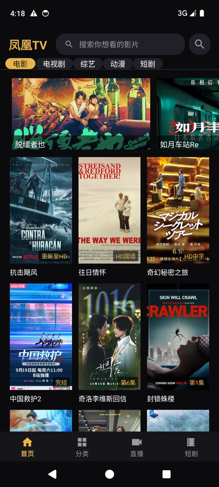
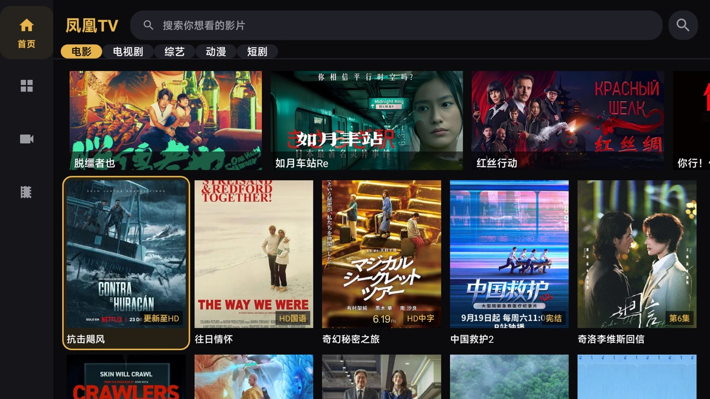

# 凤凰TV

一个面向 Android 手机与 Android TV 的影视聚合客户端，复刻「电影天堂」APK 的界面与播放链路。

> [!WARNING]
> 本项目仅用于 Android 开发与网络协议的**学习研究**，不提供、不托管、不分发任何影视内容或下载资源。
> 所有内容、封面与播放地址均来自第三方接口，版权归原权利人所有。请勿用于商业用途或公开传播。
> 接口随时可能变更或失效，使用本项目产生的一切后果由使用者自行承担。

## 预览

| 手机 | Android TV |
| --- | --- |
|  |  |

<p align="center">
  
  
</p>

## 功能

- **首页**：轮播、类型切换、影片网格，滚动自动加载下一页
- **分类**：类型 / 分类 / 地区 / 年份 / 语言 / 排序六维筛选，滚动 + 填屏分页
- **搜索**：关键字搜索、结果总数提示、滚动分页（后端固定 10 条/页）
- **直播 / 短剧**：独立 Tab 与播放链路
- **详情**：多播放线路、剧集列表、简介与演职员信息
- **播放**：Media3 ExoPlayer，支持 HLS 与签名直链；播放前刷新带时效的地址
- **TV 适配**：`layout-television` 侧边导航、Leanback 启动入口、遥控器焦点高亮、TV banner
- **双端布局**：同一 APK 同时适配手机与电视

## 技术栈

- Kotlin，AndroidX，Material Components
- Media3 ExoPlayer（HLS / 直链）
- OkHttp，Glide（含自定义 base64 图片加载）
- ViewBinding，Coroutines
- minSdk 21 / targetSdk 34

## 项目结构

```
app/src/main/java/cn/dytt/replica/
├── App.kt
├── data/
│   ├── ApiClient.kt      # 请求、加密参数、响应解密
│   ├── Crypto.kt         # AES/CFB 与 IV 穿插布局
│   ├── DyttImage.kt      # base64 图片 → Glide ModelLoader
│   └── Models.kt         # 数据模型、接口与分页
└── ui/
    ├── MainActivity.kt
    ├── DetailActivity.kt
    ├── PlayerActivity.kt
    ├── SearchActivity.kt
    ├── Adapters.kt / Chips.kt
    ├── home/ category/ live/ short/
    └── ...
```

## 构建

环境：JDK 17、Android SDK 34。

```bash
export JAVA_HOME=/path/to/jdk17
./gradlew assembleDebug
```

生成：`app/build/outputs/apk/debug/app-debug.apk`。

### Release 签名

仓库不包含任何私钥。如需签名 release 包，在本地创建 `signing/keystore.properties`（已被 `.gitignore` 排除）：

```properties
storeFile=signing/your-key.jks
storePassword=******
keyAlias=your-alias
keyPassword=******
```

然后：

```bash
./gradlew assembleRelease
```

没有该文件时 release 产物为未签名包，debug 包不受影响。离线环境下若 lint 依赖拉取失败，可追加：

```bash
./gradlew assembleRelease -x lintVitalRelease -x lintVitalAnalyzeRelease
```

## 接口与协议（学习记录）

客户端仅调用第三方公开接口，主要路径：

| 接口 | 用途 |
| --- | --- |
| `/api/app/home` | 首页类型 |
| `/api/app/vodClass` | 筛选字典 |
| `/api/app/vodList` | 分类列表（分页） |
| `/api/app/searchList` | 搜索（分页） |
| `/api/app/slideshow` | 首页轮播 |
| `/api/vod/details` | 详情与播放线路 |
| `/api/vod/play` | 按线路取剧集/播放地址 |
| `/api/live/list` | 直播 |
| `/api/short/list` | 短剧 |

实现要点：

- 响应为 `{"code":1,"msg":"...","data":"<hex>"}`，`data` 使用 AES/CFB 解出 JSON；IV 不是随数据一起顺序存放，而是插在密文十六进制串的中部，需要按固定位置拆分后重组。
- 列表接口固定 10 条/页，返回 `count` 与 `page_total`，必须翻页；仅取第一页会显得“内容很少”。
- 详情只带第一条线路的剧集，其余线路通过 `/api/vod/play?id=&player=` 单独获取。
- `type=1` 线路是带签名与时间戳的直链，播放前需要重新取一次以刷新有效期。
- 直播地址路径中没有 `.m3u8`，Media3 无法推断类型，需要显式指定 HLS；部分直播会 302 到明文 HTTP。
- 封面 CDN 返回 base64 文本，需先解码再交给图片库。

## 已知限制

- 完全依赖第三方接口，域名、密钥或数据结构变更后可能失效。
- 搜索结果排序由服务端决定，精确片名可能出现在较后的页面。
- 播放地址有有效期，离线缓存/分享地址会很快失效。
- 已在 Android 9 电视与 Android 14 模拟器上验证；其他系统版本未逐一测试。

## 合规与隐私

- 本项目不包含任何影视文件，也不提供下载能力。
- 应用图标、TV banner 与 README 预览图中的人像由项目发起人提供并授权用于本项目，**请勿转载或另作他用**。
- 仓库不包含签名私钥、口令、本机 SDK 路径等敏感信息。
- 未附加开源许可证；代码仅供学习交流，不授予商业使用许可。若相关权利人认为本项目不妥，请联系删除。
